<div align="center">

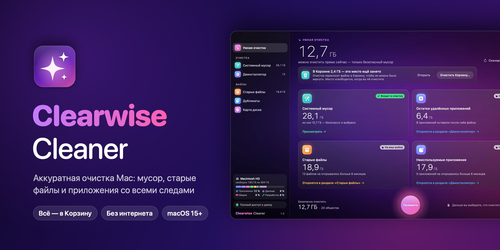

<br>

<a href="../../releases/latest"></a>

<sub>Бесплатно · macOS 15 и новее · Apple silicon и Intel · [Что нового](CHANGELOG.md)</sub>

<br>


[](LICENSE)

</div>

---

## Что умеет

| | |
|---|---|
| **Умная очистка** — одно сканирование: мусор, остатки удалённых приложений, старые файлы и неиспользуемые программы. Безопасное выбрано сразу, остальное — на ваш выбор. | 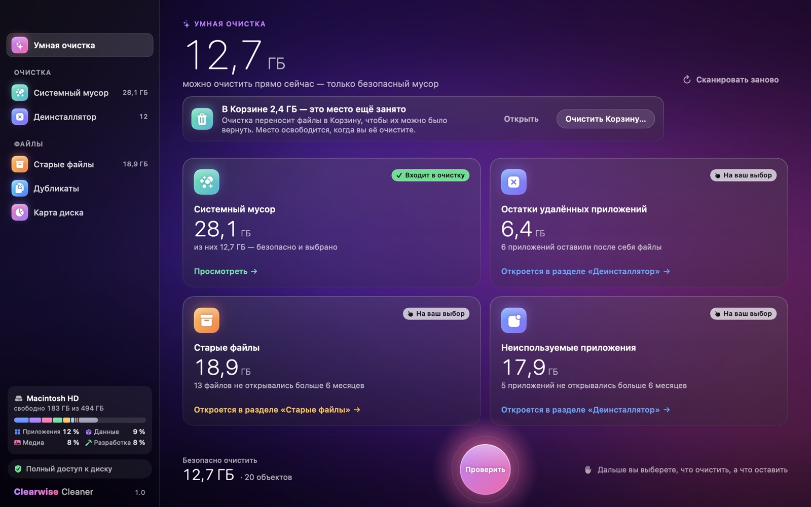 |
| **Системный мусор** — кэши приложений и браузеров (без истории, паролей и cookies), кэши приложений на Electron (Slack, Discord, VS Code и др.), журналы, отчёты о сбоях, Xcode DerivedData, кэши npm / pip / Homebrew, старые установщики, временные файлы. | 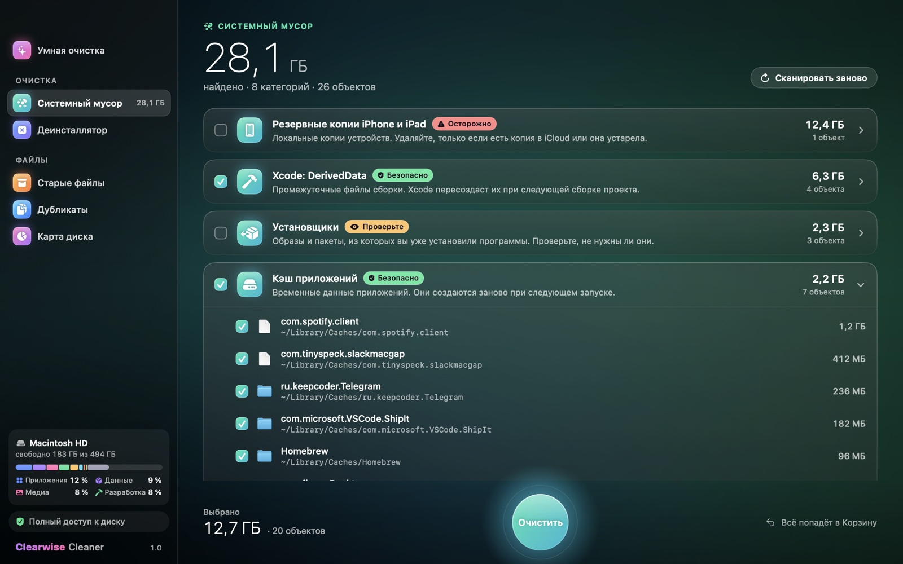 |
| **Деинсталлятор** — удаляет приложение вместе с настройками, кэшами, контейнерами, агентами запуска и помощниками. Отдельная вкладка находит следы приложений, которые уже удалили перетаскиванием в Корзину. | 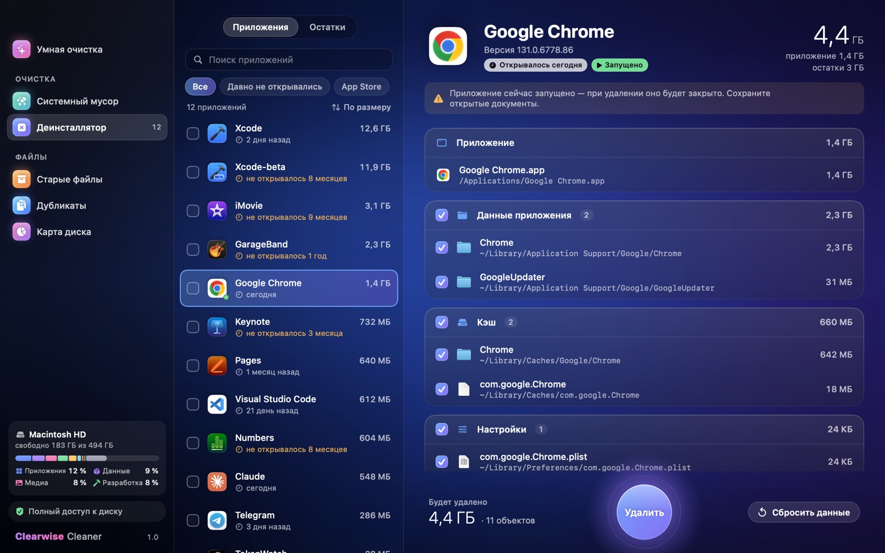 |
| **Старые и большие файлы** — то, что вы не открывали месяцами, и самые крупные файлы. Ничего не выбирается само. | 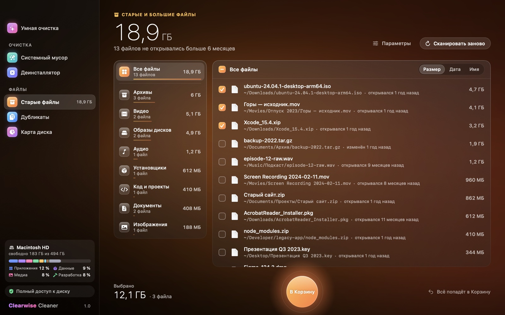 |
| **Дубликаты** — одинаковые файлы по содержимому, а не по имени. Одна копия всегда остаётся. | 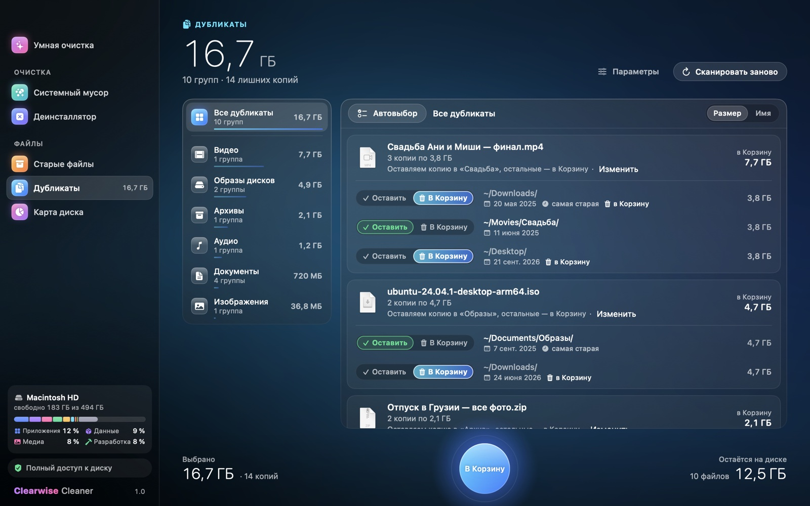 |
| **Карта диска** — диаграмма-«солнце»: щелчок открывает папку, лишнее собирается в «Сборщик». | 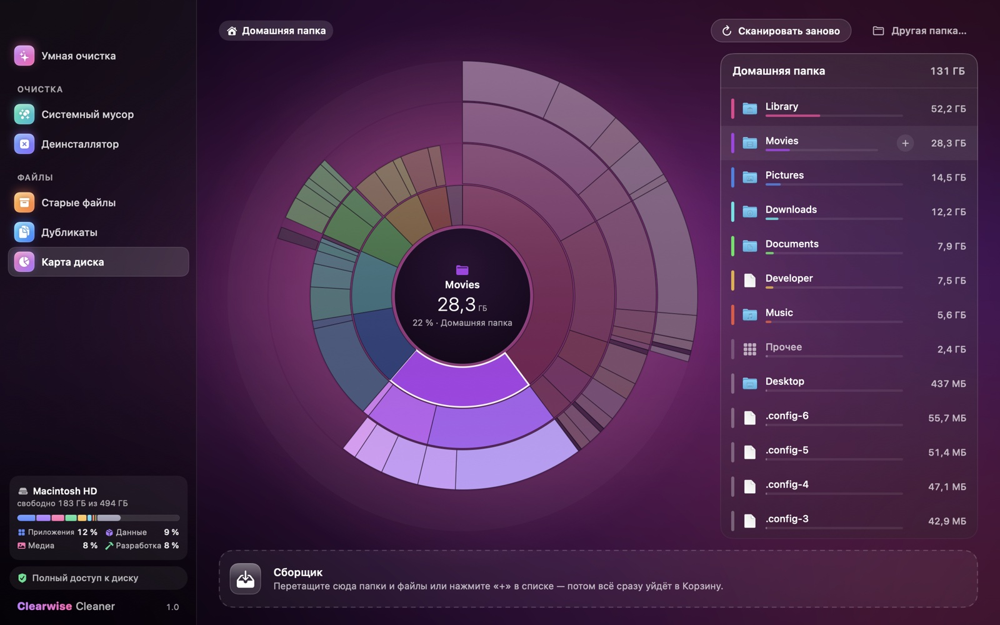 |
| **Здоровье Mac** — износ аккумулятора и SSD, свободное место и программы только для Intel, которым скоро не хватит Rosetta. Только проверка: ничего не меняет и не удаляет. | 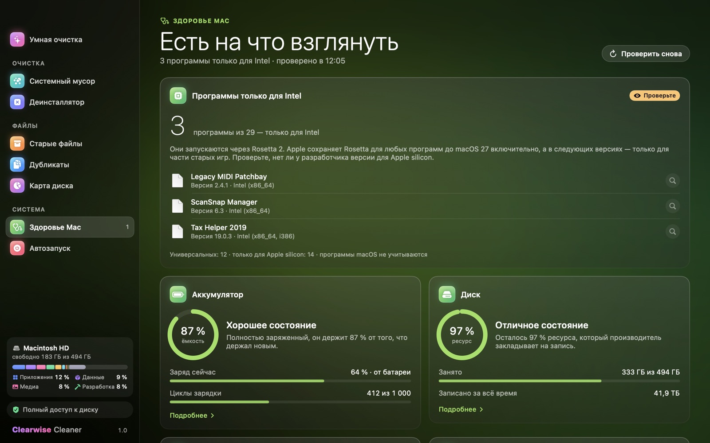 |
| **Автозапуск** — что стартует вместе с Mac: агенты, системные службы и объекты входа, с владельцем, подписью и состоянием. Выключить можно обратимо, удалить — в Корзину (сама программа остаётся). Службы macOS не трогаются. | 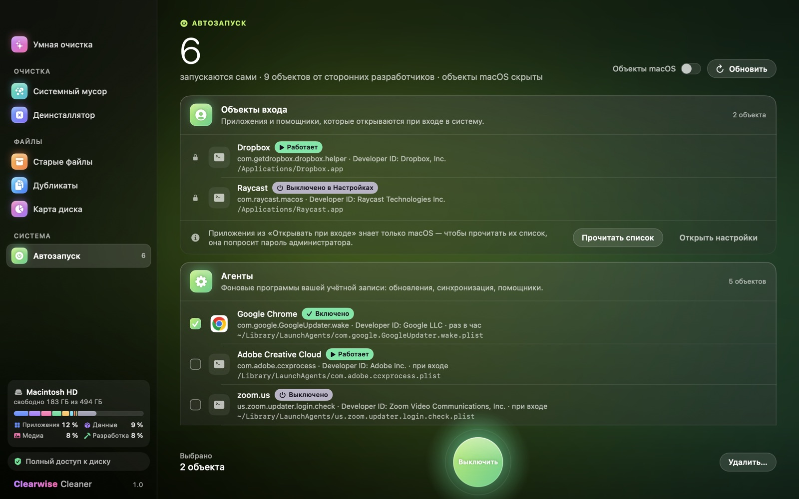 |
| **Хранилище** — чем занят диск по категориям, в процентах и гигабайтах. Любую категорию можно раскрыть до файлов, даже «Система и прочее». | 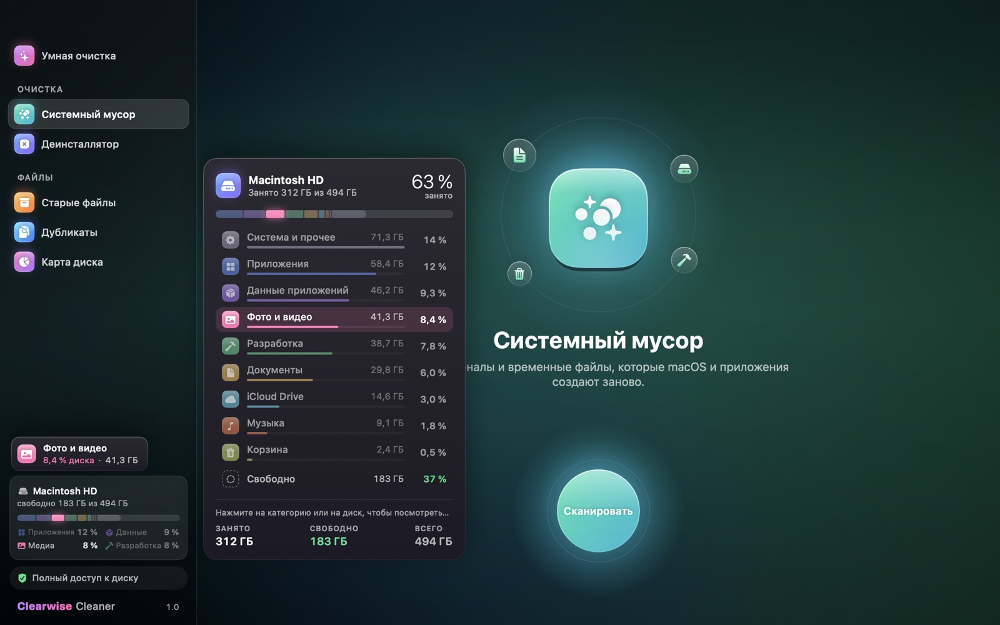 |

<div align="center">
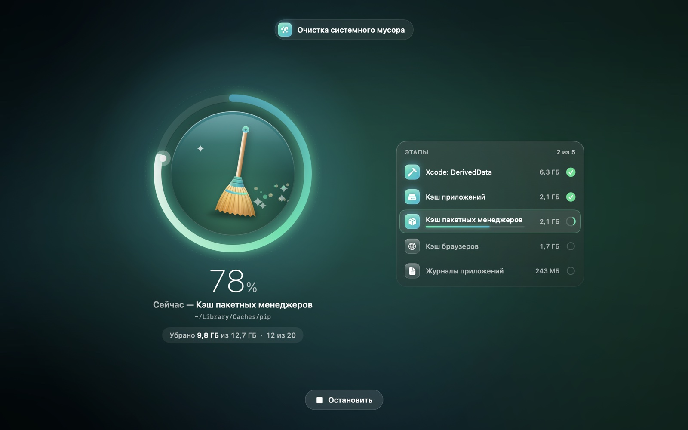 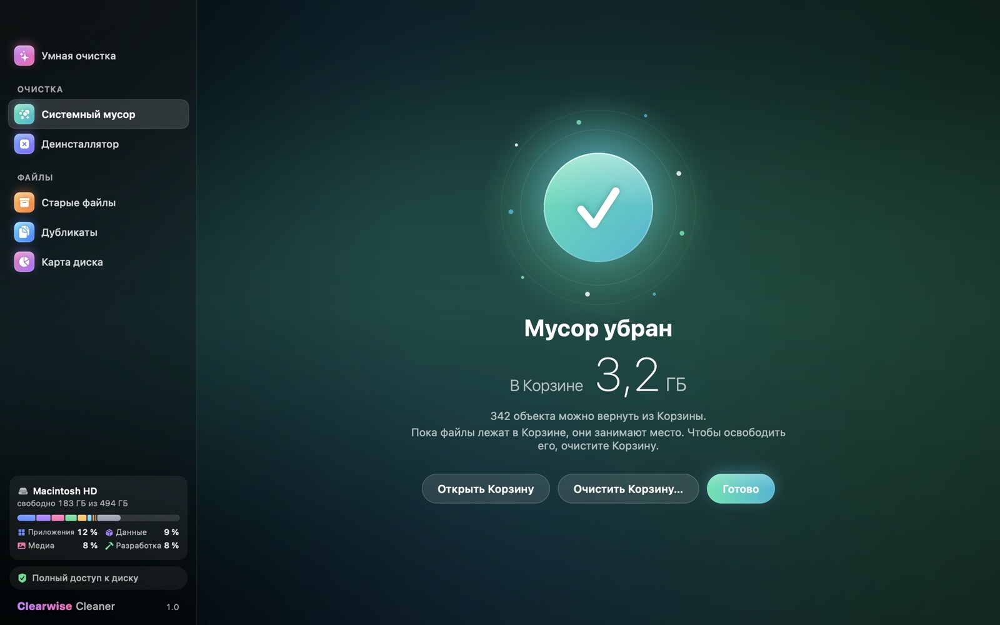
<br><sub>Очистка с понятным прогрессом и честный итог: «В Корзине 2,1 ГБ», а не «освобождено» — пока Корзина не очищена.</sub>
</div>

## Безопасность — по умолчанию

- **Всё уходит в Корзину.** Безвозвратно удаляется только содержимое самой Корзины — и только после отдельного подтверждения. Удалить сразу навсегда, минуя Корзину, можно лишь по явной галочке в диалоге очистки или по переключателю в Настройках.
- **Защищённые места не трогаются никогда:** системные папки, Связка ключей, Почта, Сообщения, iCloud Drive, медиатеки «Фото» и «Музыка», встроенные приложения macOS.
- **Личные файлы не выбираются автоматически** — только безопасный мусор. Перед удалением виден полный путь каждого файла.
- **Без интернета.** Приложение ничего не отправляет и не собирает: ни аналитики, ни телеметрии.

## Установка

1. Скачайте `Clearwise-Cleaner-<версия>.dmg` со [страницы релизов](../../releases/latest).
2. Откройте образ и перетащите **Clearwise Cleaner** в папку **Программы**.
3. **Первый запуск.** Приложение не заверено Apple (для этого нужен платный аккаунт разработчика), поэтому macOS спросит подтверждение:
   - откройте приложение двойным щелчком и нажмите «Готово» в предупреждении;
   - зайдите в **Системные настройки → Конфиденциальность и безопасность** и нажмите **«Всё равно открыть»** рядом с Clearwise Cleaner.

   Это нужно сделать один раз.
4. **Полный доступ к диску** (по желанию, но без него часть мусора не видна): приложение само покажет, где его включить.

> Проверить, что файл не изменён по дороге: `shasum -a 256 Clearwise-Cleaner-*.dmg` и сравнить с файлом `.sha256` в релизе.

## Сборка из исходников

Нужны macOS 15+ и Xcode 16+ (Swift 6).

```bash
scripts/build_app.sh                         # build/Clearwise Cleaner.app
swift test                                   # тесты движков
VERSION=1.0.0 scripts/package_release.sh     # build/Clearwise-Cleaner-1.0.0.dmg для релиза (Apple silicon + Intel)
```

Оформленное окно DMG (фон со стрелкой к «Программам») собирает [dmgbuild](https://pypi.org/project/dmgbuild/): `python3 -m venv build/.venv && build/.venv/bin/pip install dmgbuild`. Без него получится обычное окно. Обложку и фон рисует `scripts/make_art.swift`.

`build_app.sh` подписывает приложение первым сертификатом «Apple Development» из связки ключей (тогда Полный доступ к диску не слетает после пересборки), иначе — ad-hoc. Релизный DMG всегда подписывается ad-hoc: в сертификате разработчика записан его Apple ID.

## Как устроено

| Модуль | Что внутри |
|---|---|
| `Sources/CleanerKit` | Модели, единственная точка удаления `FileRemover`, защита путей `SafetyGuard` |
| `Sources/JunkEngine` | Каталог и поиск мусора |
| `Sources/UninstallEngine` | Список приложений, поиск их следов и остатков удалённых |
| `Sources/SpaceEngine` | Старые и большие файлы, карта диска, дубликаты, разбивка хранилища |
| `Sources/HealthEngine` | Аккумулятор, SSD, память и архитектура программ — только чтение |
| `Sources/StartupEngine` | Агенты, службы и объекты входа: список, выключение, включение, удаление |
| `Sources/MacCleaner` | Интерфейс на SwiftUI. С флагом `--snapshot <папка>` (отладочная сборка) сохраняет скриншоты всех экранов на демо-данных |

## Лицензия

[MIT](LICENSE) — пользуйтесь, меняйте и распространяйте свободно, сохранив упоминание авторов.
